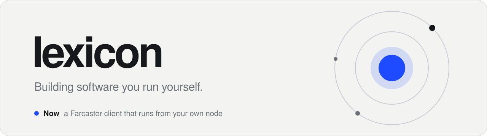

<picture>
  <source media="(prefers-color-scheme: dark)" srcset="assets/banner-dark.svg">
  
</picture>

 

I make small products people get in one look. Farcaster, Base, onchain.

### Now

**A Farcaster client that runs from your own node.**
Three commands give you a Snapchain read node, a clean client and your own app key. No API keys, no middleman. Repo is landing this week.

### Made

- **$PILL**, a memecoin on Base with its own corner of Farcaster, [@pilll](https://farcaster.xyz/pilll)
- **Daily PILL**, a Farcaster mini app: one pull a day, limited editions minted onchain

### How I build

Ship the smallest useful thing. Cut everything else. Then listen.

 

[Farcaster](https://farcaster.xyz/pilll)
